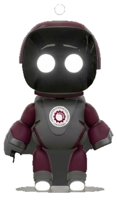
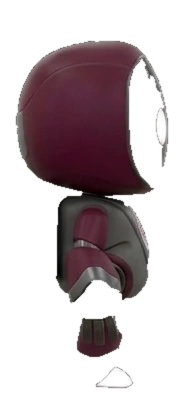
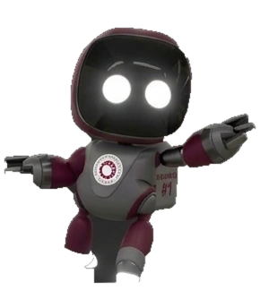
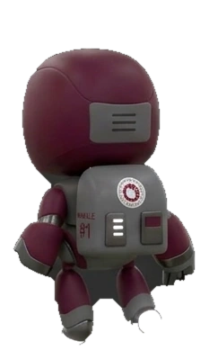

#  ASTRO RUN

[](https://unity.com)
[](https://developer.mozilla.org/en-US/docs/Web/API/WebGL_API)
[](LICENSE)

> **Endless Runner 3D Espacial** - Explora rutas orbitales desde la Tierra hasta Saturno

---

##  Descripción

**ASTRO RUN** es un emocionante juego de carreras infinitas en 3D desarrollado en Unity. Acompaña a nuestro robot explorador universitario en una misión espacial que lo llevará desde la órbita terrestre hasta los anillos de Saturno. Esquiva satélites, cohetes, rocas espaciales y meteoritos mientras alcanzas la puntuación objetivo de **1,500 puntos**.

---

## 🎮 Características

- ** Dos Mundos Únicos**: Comienza en la órbita terrestre y transicióna hacia Saturno al llegar a los 600 metros
- ** Personaje Personalizado**: Robot ASTRO con diseño Sci-Fi Cartoon y emblema de la Universidad Privada del Valle
- **⚡ Gameplay Dinámico**: Controles responsivos y aceleración progresiva (12 u/s → 29 u/s)
- **🎯 Sistema de Puntuación**: 
  - +10 puntos por segundo de supervivencia
  - +5 puntos adicionales por obstáculo esquivado
- **💫 Efectos Visuales**: Entornos 3D con iluminación dinámica y partículas espaciales
- **🎵 Audio Inmersivo**: Banda sonora y efectos de sonido espaciales

---

## 🕹️ Controles

| Acción | Teclado |
|--------|---------|
| **Saltar** | `↑` Flecha Arriba / `Espacio` |
| **Agacharse** | `↓` Flecha Abajo / `S` |
| **Pausar** | `ESC` |
| **Reiniciar** | `R` |

---

## 🎯 Objetivo del Juego

1. **Supervivencia**: Mantente vivo esquivando obstáculos
2. **Puntuación**: Alcanza **1,500 puntos** para completar la misión
3. **Vidas**: Comienzas con **3 vidas** - ¡no las pierdas todas!
4. **Progresión**: Llega a los **600 metros** para desbloquear el entorno de Saturno

---

## ️ Galería

### Vistas del Personaje

<div align="center">
  <table>
    <tr>
      <td align="center"><b>Vista Frontal</b></td>
      <td align="center"><b>Vista de Perfil</b></td>
    </tr>
    <tr>
      <td align="center"></td>
      <td align="center"></td>
    </tr>
    <tr>
      <td align="center"><b>Vista de Acción</b></td>
      <td align="center"><b>Vista Posterior</b></td>
    </tr>
    <tr>
      <td align="center"></td>
      <td align="center"></td>
    </tr>
  </table>
</div>

---

## 🛠️ Tecnologías Utilizadas

- **Motor**: Unity 6000.6.0f1
- **Renderizado**: WebGL 2.0
- **Lenguaje**: C#
- **Modelado 3D**: Blender / Maya
- **Texturas**: Formato WebP optimizado
- **Despliegue**: GitHub Pages

---

## 📥 Instalación y Ejecución

### Opción 1: GitHub Pages (Recomendado)
El juego está disponible directamente en nuestro portal web. Simplemente visita la página y haz clic en **"Jugar Ahora"**.

### Opción 2: Local
1. Clona el repositorio:
   ```bash
   git clone https://github.com/tu-usuario/astro-run.git
   cd astro-run
